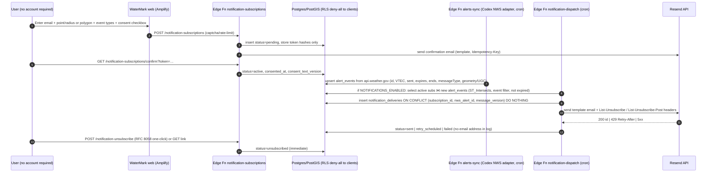

# WM-GROK-001: WaterMark alerts and external integrations (research report)

| Field | Value |
|---|---|
| Task | WM-GROK-001, Integration Researcher / Notification Systems Engineer / Technical Reviewer |
| Human owner | Decong |
| Branch | `research/decong-alert-integrations` (from the task). **Conflict:** README §10 proposes `feat/decong-agentboxd` and `infra/decong-domain`. No branch was created; the owner picks one before any code. |
| Status | **Research only.** No sign-ups, sends, DNS or infra changes, repo edits, or secrets. |
| Prepared | Sat Nov 21, 2026, about 2:50 to 3:20 PM ET |
| Deadline | Sun Nov 22, 2026, 3:00 PM ET (Devpost: 12:00 PM PST) [V] https://evohacks2.devpost.com/rules |
| Inputs read | Master Handoff (parent conversation), `README.md` and `AGENTS.md` (copies of `main` at `/workspace/watermark-docs/`), and the earlier report `/workspace/watermark/alert-integrations-research.md` |

**Tag legend (on every claim):**
- **[V] Verified**: read on the cited official or primary page, or observed in an anonymous read-only public API call made today.
- **[3P] Third-party**: secondary source or search summary only.
- **[A] Assumption**: my inference or design proposal.

**Live read-only checks made today (anonymous, no keys):**

| Call | Result |
|---|---|
| `api.weather.gov/alerts?event=Flood%20Warning&limit=1` | 200 GeoJSON. Fields confirmed: `id`, `sent`, `effective`, `onset`, `expires`, `ends`, `status`, `messageType` (`Update`), `references[]`, `parameters.VTEC` (`/O.CON.KMLB.FL.W.0003…/`), `geocode.SAME/UGC`, cursor `pagination.next`. [V] |
| `api.weather.gov/alerts/active?area=NY` (GeoJSON and `Accept: application/atom+xml`) | 200, 0 active NY alerts at about 19:50 UTC (2:50 PM ET). The ATOM variant returns a CAP 1.2 namespaced feed. [V] |
| FEMA IPAWS public feed `apps.fema.gov/IPAWSOPEN_EAS_SERVICE/rest/public/recent/<ts>` | 200 `application/xml`, an empty `<ns1:alerts>` for the last 2 h. [V] |
| OpenFEMA `api/open/v1/IpawsArchivedAlerts?$top=1` | 200 JSON with `identifier`, `sender`, `sent`, `status`, `msgType`. [V] |
| Notify NYC CAP RSS `feeds.everbridge.net/feeds/453003085617722/rss/rss.xml` (linked from the Notify NYC FAQ) | 200, channel "Notify NYC CAP RSS Feed", 0 items at 19:49 UTC (2:49 PM ET). [V] |

**Repo-doc alignment notes:**
- README §7 lists the proposed, unversioned public endpoints `GET /alerts?lat=&lon=` and others. These share one response envelope (`status`, `location`, `kind`, `source`, `observedAt`, `forecastIssuedAt`, `validFrom`, `validTo`, `fetchedAt`, `units`, `data`, `qualityFlags`, `limitations`) and the enum `dataStatus: available | stale | unavailable | unsupported | error` [V, README §4/§7].
- AGENTS.md: "Do not add Cloudflare, Lambda/API Gateway, another database, or a proxy" [V]. **So Cloudflare Registrar (which forces Cloudflare DNS) is excluded from the domain plan.**
- AGENTS.md: "Alerts by email/SMS: Supplemental and potentially delayed. Do not treat email summary arrival as proof of a current alert." [V]
- README §13: "Do not represent simulated alert emails, test fixtures, or historical replay as current emergency guidance." [V]

---

## Executive summary

1. **Agentboxd is suitable for inbound alert-email ingestion, but not alone for consumer notifications.**
   - Inbound strengths [V]: REST/SDK inbox creation, SPF/DKIM/DMARC checks surfaced as labels and an `Authentication-Results` header, AI injection and phishing scoring with a hold-from-agent quarantine, HMAC-signed webhooks, and a claim/ack polling queue.
   - Why it can't be the consumer sender [V]:
     - Its send API has **no custom-header field**, and SMTP sends drop "other headers". So it cannot emit `List-Unsubscribe` / RFC 8058 one-click headers.
     - Messages are capped at 50 recipients.
     - It runs on a shared IP, with "one-to-one and small-group mail, not bulk campaigns".
     - New workspaces are limited to **20 sends/day for 3 days**.
   - **Use Resend (or an equivalent) for consumer notification email.**
2. **No official source sends warnings by email that WaterMark can consume better than an API.**
   - NWS sends no public email. Its partner email service iNWS was **decommissioned on Oct 22, 2026** (SCN 26-92), and NWS points the public to third parties and local emergency management.
   - FEMA's GovDelivery email covers news and updates, not warnings.
   - The machine-readable sources are better: the NWS API (CAP/ATOM/GeoJSON), the IPAWS public CAP feed, and Notify NYC's own CAP RSS feed.
   - Real email-only official sources: Notify NYC email, NY-Alert email, and **USGS WaterAlert** (gauge-threshold email, still operating).
3. **NWS `api.weather.gov` remains authoritative.** Email is stored as an "unverified email report" unless matched to an NWS record by VTEC, event, area, and time. An expired, cancelled, or superseded NWS record always wins.
4. **Notification flow:** NWS record → `alert_events` → PostGIS match → fixed template → Resend.
   - Double opt-in and one-click unsubscribe (RFC 8058).
   - Dedupe on `(subscription_id, nws_alert_id, message_version)`.
   - **`NOTIFICATIONS_ENABLED` defaults to `false`.**
5. **SMS: NO-GO** before the deadline. Toll-free verification takes 3 to 5 business days at Twilio and up to 15 at AWS, 10DLC needs a paid account plus vetting, and trial accounts only reach verified numbers.
6. **Domain:** Porkbun $1.29 for year one [V]. Amplify via Route 53 (up to 24 h) or Porkbun DNS with ALIAS + CNAMEs (up to 48 h) [V]. Start only after Ryan B confirms the Amplify app and branch, and keep `*.amplifyapp.com` as the fallback URL.
7. **Sponsor:** the "Best Use of Agentboxd" prize requires a project that "meaningfully uses Agentboxd", with all team members 16+ [V]. Ingesting official email-only alerts with injection screening and official-record linking is a **genuine but modest** use. Don't build it just for the prize, and keep it P1 behind P0.

---

## 1. Verified Agentboxd capability assessment

Primary docs: https://agentboxd.com/docs/api (OpenAPI 3.1; add `.md` to any docs URL), https://agentboxd.com/docs/webhooks, https://agentboxd.com/docs/deliverability, https://agentboxd.com/docs/custom-domains, https://agentboxd.com/docs/smtp, https://agentboxd.com/pricing

### 1.1 Inbox creation and management [V]
- Base URL `https://api.agentboxd.com`, header `Authorization: Bearer <api_key>`.
- Keys are scoped to the workspace or to one inbox, with granular permissions (`inboxes:read|write`, `messages:read|send|write`, `webhooks:manage`, `domains:manage`, …) and presets `read_only` and `send_read`. Keys can expire.
- `POST /v1/inboxes` takes `{ username?, display_name?, client_id?, metadata?, domain? }` and is idempotent on `client_id`. The default domain is `homingbox.net`; a verified custom domain is optional.
- `GET/PATCH/DELETE /v1/inboxes/:id`. `POST /v1/inboxes/:id/pause` and `/resume` are the send kill switch; inbound mail is still stored.
- `POST /v1/lists` takes `{ inbox_id?, direction: receive|send|reply, kind: allow|block, pattern }` and supports address or domain patterns (sender allow lists).
- SDKs: npm `agentboxd` (latest 0.3.1, https://registry.npmjs.org/agentboxd) and PyPI `agentboxd` (Beta, https://pypi.org/pypi/agentboxd/json).

### 1.2 Inbound trust assessment [V]
- **SPF/DKIM/DMARC:** "Our mail server checks SPF, DKIM and DMARC on every inbound message and writes an Authentication-Results header. A failure adds spf-fail or dmarc-fail." Message objects include `headers` and `labels`, and the raw MIME is at `GET /v1/messages/:id/raw` (https://agentboxd.com/).
- **Injection screening:** the JEV triage writes `message.ai.risk.injection` and `risk.phishing` (probabilities), `category`, `urgency`, `needs_human`, and `auto_reply`, plus labels such as `ai:injection-risk` and `ai:phishing`, and local labels (`local:injection-risk`, `local:spam`).
- **Holding:** likely injections are **held**. API keys see only metadata (subject replaced by `[held:]`) until a person releases the message. Releasing requires `messages:release`, which is in no preset. Holding is on by default for new workspaces.
- **AI processing** can be switched off, in which case no content goes to a model (https://agentboxd.com/docs/ai-processing).
- **Caveats:** Agentboxd calls these "guardrails, not guarantees" [V]. Bulk-formatted mail (List-Unsubscribe or `Precedence: bulk` with marketing wording) may be labelled `local:spam` [V]. Official alert lists might trip this, so test with real mail [A].

### 1.3 Retrieval [V]
| Mode | Details |
|---|---|
| **Webhook** | `POST /v1/webhooks` takes `{ url, events?, inbox_ids?, secret?, payload: "full"|"envelope", headers? }` and needs a public HTTPS URL. Events: `message.received`, `message.enriched` (after AI triage, at most once), `message.released`, `message.received.blocked`, and others. The **envelope** payload carries only `{ inbox_id, thread_id, message_id, from, to, subject, labels, received_at }`, with the body fetched via `GET /v1/messages/:id`. **Signature:** `X-Mailroom-Timestamp` (unix s) and `X-Mailroom-Signature = hex(HMAC-SHA256(secret, "<timestamp>.<raw body>"))`; verify on the raw body, reject timestamps more than 300 s off, and compare in constant time (the SDK exports `verifyWebhook`). Delivery is retried 8× with backoff from 680 s, about 24 h in total, and a non-2xx or 10 s timeout counts as a failure. **One message can arrive up to 3 times** (received, enriched, released). |
| **Polling / queue** | `POST /v1/inboxes/:id/messages/claim` takes `{ limit≤50, lease_seconds, enriched?, analysis?, since? }` and returns `{ lease_id, delivery_count, message }`; follow with `POST /v1/messages/:id/ack` or `nack` (with `delay_seconds`). `GET /v1/inboxes/:id/messages/wait` is a long poll of up to 60 s. **A good fit for a Supabase cron function with no public webhook** [A]. |
| WebSocket / IMAP / SMTP | Available (https://agentboxd.com/docs/realtime-events, /docs/imap, /docs/smtp). Not recommended for Edge Functions [A]. |

### 1.4 Sending capability and limits [V]
- `POST /v1/inboxes/:id/messages/send` takes `{ to, cc?, bcc?, subject, text?, html?, attachments?, labels?, send_at?, reply_to?, … }` and returns 202 `queued`, honouring `Idempotency-Key`. **There is no `headers` field.** SMTP: "Other headers are not carried over" (https://agentboxd.com/docs/smtp).
- **Limits** (https://agentboxd.com/docs/deliverability, /pricing):

  | Limit | Value |
  |---|---|
  | Free plan | 100 sends/day, 20 per 5 min, 3,000 emails/mo in + out |
  | Builder plan (EvoHacks 30-day perk) | 2,000/day, 200 per 5 min |
  | **New workspace, any plan** | **20/day (10 per 5 min) for the first 3 days** |
  | Recipients per message | 50 |
  | Hard bounces | Sending pauses above 5 %/7 d |
  | Complaints | Sending pauses above 0.1 %/7 d |
- **Bounces:** hard bounces and complaints are added to a suppression list, and further sends get `422 recipient_suppressed`. Message `status` moves through `queued|sent|delivered|bounced|complained|failed`, and events include `message.bounced`. `GET /v1/deliverability` reports rates, SPF/DKIM/DMARC status, and whether the shared IP is blocklisted.
- **Deliverability posture:** "Every workspace shares our sending IP…", "One-to-one and small-group mail, not bulk campaigns", warm-up over "a few weeks". Each sent email carries a DKIM-signed AI-disclosure header (https://agentboxd.com/docs/ai-disclosure).

### 1.5 Suitability as a consumer notification sender
| Requirement | Agentboxd | Evidence |
|---|---|---|
| One-click unsubscribe (RFC 8058 `List-Unsubscribe` + `List-Unsubscribe-Post`) | **Not supported** (no custom headers) | [V] send API fields; SMTP drops headers |
| Bulk/subscriber fan-out | Not intended (50 recipients, shared IP) | [V] deliverability doc |
| Bounce/complaint handling | Supported (suppression list, events) | [V] |
| Volume for a demo | 20/day on a new workspace | [V] |
| Gmail rule | Senders of 5,000+/day must support one-click unsubscribe for "subscribed messages" | [V] https://support.google.com/a/answer/81126 (WaterMark is far below that, but it is still best practice) |

**Verdict:**
- **Agentboxd alone does not suffice** for consumer notifications. **Use Resend** for outbound subscriber mail. Resend supports custom headers, including `List-Unsubscribe` and `List-Unsubscribe-Post: List-Unsubscribe=One-Click` per RFC 8058, plus `Idempotency-Key` and Svix-signed webhooks [V] https://resend.com/docs/llms-full.txt.
- Agentboxd stays the **inbound** component. Optionally it can send one-to-one replies, such as acknowledging a forwarded report [A].
- **Resend caveat:** "By default, you can only send emails to your own email address" until a domain is verified [V]. Without the `.xyz` domain, the outbound demo can only go to the Resend account owner's inbox (acceptable for a labeled demo) [A].
- Resend Free allows 100/day and 3,000/mo, at 10 req/s per team [V] https://resend.com/pricing, https://resend.com/docs/knowledge-base/resend-email-quota.
- **Supabase Edge Functions block outbound ports 25 and 587** [V] https://supabase.com/docs/guides/functions/limits. Use HTTPS APIs only.

---

## 2. Official warning-email availability

| Source | Official email? | Sender authenticity | Machine-readable alternative | Recommendation |
|---|---|---|---|---|
| **NWS (public)** | **No public email.** The NWS LWX FAQ says NWS alerts go via NOAA Weather Radio, media, and WEA, and points to private apps and local EM sign-ups [V] https://www.weather.gov/lwx/faq. NWS lists *third-party* email providers with "NWS does not endorse" [V] https://www.weather.gov/enterprise/sw-alerts-email-1a. The dissemination table lists email only for **iNWS (restricted)** and "Local Emergency Agency" [V] https://www.weather.gov/nwws/dissemination | n/a | **`api.weather.gov` alerts** (GeoJSON default; CAP and ATOM via Accept; User-Agent with contact required; rate limit "not public… generous") [V] https://www.weather.gov/documentation/services-web-api | **Primary source (P0).** Do not ingest third-party NWS re-mailers. |
| **iNWS** (NWS partner email/SMS) | Was partner-only. **Decommissioned Oct 22, 2026:** "No new users will be able to register" [V] https://www.weather.gov/media/notification/pdf_2026/scn26-92_iNWS_Decommission.pdf | n/a | n/a | Not available. |
| **NOAA Weather Wire (NWWS-OI)** | No (XMPP chatroom) | NWS-issued credentials | XMPP. Credentials are requested by email to NWWS.Issue@noaa.gov, take "10-days or more", and can take "30+ days" [V] https://www.weather.gov/nwws/nwws_oi_request, https://www.weather.gov/nwws | Not feasible in 24 h, and not needed. |
| **FEMA IPAWS All-Hazards Information Feed** | No | Alerts are "digitally signed by the alerting authority" [V] | CAP 1.2 over HTTP. Alerts stay on the feed "30 minutes or until they expire". Redistribution requires registering on the IPAWS User Portal [V] https://www.fema.gov/emergency-managers/practitioners/integrated-public-alert-warning-system/technology-developers/all-hazards-information-feed. The public endpoint responded anonymously today [V]. The 120 s polling guidance is [3P] easstation.com | **P2.** Register before redistributing. NWS API covers flood alerts. |
| **FEMA email (GovDelivery)** | Yes, but news and updates topics ("notices, updates, and subscriptions"), not warnings [V] https://public.govdelivery.com/accounts/USDHSFEMA/subscriber/new | GovDelivery (DHS contractor) [V] | OpenFEMA API, e.g. `IpawsArchivedAlerts` (historical) [V] https://www.fema.gov/about/openfema/data-sets | Not a warning source; skip. |
| **FEMA app** | Push, not email. It delivers NWS alerts [3P] | n/a | n/a | Point users to it in the resources list. |
| **Notify NYC** (NYCEM) | **Yes:** email, SMS, phone, app, RSS, X. Enrollment needs an NYC ID or social login and email confirmation. Emergency Alerts are required; Weather is optional; there is a basement-apartment option [V] https://a858-nycnotify.nyc.gov/Home/FAQ, https://www.nyc.gov/site/em/ready/be-ready-new-york.page | The FAQ names **notifynyc@oem.nyc.gov** for allow-listing [V]. The actual alert From address is **[A] unverified** (the platform is Everbridge-hosted per the RSS URL [V], so mail may come from an Everbridge domain) | **Notify NYC CAP RSS:** `https://feeds.everbridge.net/feeds/453003085617722/rss/rss.xml` (from the FAQ link; 200 today, 0 items) [V]. The FAQ notes RSS "may lag behind email and text" [V] | **Prefer CAP RSS polling** for NYC notices. Email via Agentboxd is an optional supplement. **Terms:** NYC.gov content is "property of the City of New York. All rights are reserved" [V] https://www.nyc.gov/main/terms-of-use. Show short excerpts with a link, not full reposts [A]. |
| **NYC Emergency Management** | Via Notify NYC (above) [V] | as above | as above | as above |
| **NY-Alert** (NYS) | **Yes:** email, text, phone, fax, per location and alert type, via an NY.gov account [V] https://alert.ny.gov/about, https://alert.ny.gov/sign-up-ny-alert | **[A] unverified** sender domain | Not found **[A]** | Optional Agentboxd source. |
| **County EM (NJ/NY counties, Outer Banks)** | Varies; NWS says check local EM [V] (dissemination table) | Varies | Varies | Out of scope for the hackathon [A]. |
| **NOAA Tides & Currents (CO-OPS)** | **No threshold email found.** The Coastal Inundation Dashboard shows on-screen alerts only [3P] https://tidesandcurrents.noaa.gov/inundationdb_info.html | n/a | CO-OPS Data API https://api.tidesandcurrents.noaa.gov/api/prod/ [V, README] | Use the API (Codex adapter). |
| **USGS WaterAlert** | **Yes, still operating:** email or SMS (short code 31238) when a gauge parameter crosses a user threshold, hourly or daily [V] https://accounts.waterdata.usgs.gov/wateralert/service/, user guide https://accounts.waterdata.usgs.gov/wateralert/user-guide/. Uses provisional data; "informational service only… might not reach you in a timely manner during an emergency" [V] | USGS (sender domain **[A] unverified**) | USGS Water Data APIs https://api.waterdata.usgs.gov/ [V, README] | A good **real, official, predictable** email source for an Agentboxd demo (see §9). The API stays primary for values. |

**Bottom line [A]:** every flood-relevant official stream has a machine-readable option (NWS API, IPAWS CAP, Notify NYC CAP RSS, USGS API, CO-OPS API). Email ingestion therefore adds value only for **email-only sources** (NY-Alert, WaterAlert threshold notices, local EM lists) and as a cross-check. It must never be the primary path.

---

## 3. Ingestion architecture (Workstream A)

```
Official email (Notify NYC / NY-Alert / USGS WaterAlert)
   └─► Agentboxd inbox  [SPF/DKIM/DMARC labels, JEV risk, receive allow-list, held-mail]
         ├─(a) signed webhook, envelope payload ─► Edge Fn alert-email-ingest
         └─(b) fallback: cron Edge Fn alert-email-sync → claim/ack queue
                 ▼
      raw_email_ingest (service-role only)  ──► deterministic parser (no LLM w/ tools)
                 ▼
      matcher ⇄ alert_events (NWS-derived, authoritative; written by Codex's NWS adapter)
                 ▼
      alert_email_links (matched | unmatched | superseded | expired)
                 ▼
      GET /alerts response: official NWS records first; optional `emailReports[]`
      labeled "unverified email report" unless linked
```

**Dedupe, in layers [A, design]:**
1. **Provider event:** unique `(provider, provider_event_id)` in a small events table, or an array column. Agentboxd may deliver `received`, `enriched`, and `released` for the same message [V].
2. **Provider message:** unique `(provider, provider_message_id)`.
3. **RFC 5322 `Message-ID`:** unique where present. It catches the same mail via webhook and queue, or forwarded copies.
4. **Content hash:** `sha256(normalized_from_domain + normalized_subject + normalized_body_text)` flags near-duplicates across list re-sends; flagged, not dropped.
5. **Official record:** NWS `properties.id` (CAP identifier) is unique per *message version*. Group versions by the **VTEC event key** `office.phenomena.significance.ETN` (e.g. `KMLB.FL.W.0003`) [V field observed]. `references[]` links prior versions [V].

**Delayed delivery and outdated warnings [A, design; NWS fields V]:**
- Store `received_at` (provider) and the `Date:` header separately. Compute `delivery_lag = received_at − Date`.
- **Staleness gate:** if the linked NWS record has `expires` or `ends` in the past, `messageType = Cancel`, or a VTEC action of `CAN`/`EXP`, mark the link `expired` or `superseded` and never present it as current.
- Map VTEC actions per the NWS directive: NEW, CON, EXT, EXA, EXB, UPG, CAN, EXP, COR, ROU [3P summary of https://www.weather.gov/media/directives/010_pdfs/pd01017003curr.pdf].
- If a newer NWS version exists (`references` chain or a later `sent`), link the email to the version it described, but display the **current** NWS version.
- **Unmatched email older than N hours** (e.g. 6 h) is shown, if at all, only in a history list labeled "unverified email report, may be outdated".

**Linking email to official records [A, design]:**
1. **Extract** deterministically (regex and keyword tables, no LLM): event type ("Flash Flood Warning", "Coastal Flood Advisory" …), area tokens (NYC boroughs, county names, ZIPs), times, and any VTEC string if present.
2. **Candidates:** NWS records with `sent` within ±6 h of the email `Date`, the same `event` (normalized), and geographic overlap (UGC/SAME county codes, or PostGIS intersection of the NWS polygon with the geocoded area).
3. **Score:** exact VTEC match = 1.0; otherwise event + area + time scores. Link only above a threshold; otherwise status is `unmatched`.
4. **Never invert precedence.** An email cannot create, extend, upgrade, or cancel an `alert_events` row. Only the NWS adapter writes `alert_events`.

**Prompt-injection defense [A, design; Agentboxd features V]:**
1. **Authenticity:**
   - Use an Agentboxd receive allow list for official senders.
   - Require no `spf-fail`/`dmarc-fail`.
   - Verify the HMAC and timestamp on every webhook.
2. **Risk:** `risk.injection ≥ 0.2` or `risk.phishing ≥ 0.2`, or label `ai:injection-risk` / `local:injection-risk`, sets status to `quarantined` (thresholds are a team choice). Code never calls `messages:release`.
3. **Data, not instructions:**
   - Store plain text only; strip HTML, scripts, and hidden text. Cap length at 8 KB. Never follow or prefetch links.
   - No LLM with tools or DB/send access ever reads email.
   - If Ryan B's assistant summarizes, it receives sanitized text in a delimited `untrusted_email` field, with no tools, and its output is display-only, as AGENTS.md requires ("never… override official warnings") [V].
4. **No re-broadcast:** outbound notifications are built only from `alert_events` (NWS fields) and fixed templates, never from email text.
5. **Least privilege:**
   - The ingest function uses an inbox-scoped `read_only` key.
   - The sender key lives with a different provider (Resend).
   - The webhook secret is stored separately.
6. **Kill switches:** `ALERT_EMAIL_INGEST_ENABLED` (default `false`) and Agentboxd inbox pause.

---

## 4. Notification design (Workstream B)

**Flow:** Official source → verified event → subscription matching → preparation (templates only) → authorized delivery.



**Requirements mapping [A, design unless tagged]:**

| Requirement | Design |
|---|---|
| **Explicit opt-in** | Double opt-in. The confirmation link token is random 32 bytes, stored as `sha256(token + ALERT_TOKEN_PEPPER)`, and expires in 24 h. Store `consent_text_version`, `consented_at`, and a hashed IP. Nothing is sent before confirmation (handoff §10: "Do not send unsolicited emergency notifications" [V]). |
| **Geography** | A point plus radius (100 m to 25 km; the server buffers it to `geography(Polygon)`) or a polygon (validated, ≤ N vertices, area cap). Matching uses `ST_Intersects(sub.area, alert.geometry)`. For NWS alerts with null geometry, fall back to UGC/SAME codes resolved to county or zone polygons [A]. NWS `geocode.SAME/UGC` [V]. |
| **Event-type filter** | `event_types text[]`, default flood set: Flash Flood Warning/Watch, Flood Warning/Watch/Advisory, Coastal Flood Warning/Watch/Advisory [A] (the event names follow NWS `event` [V]). |
| **Which versions notify** | Notify on VTEC `NEW`, `EXA`, `EXB`, `UPG` (and optionally `EXT`). Skip `CON`/`ROU`. `CAN`/`EXP` give an optional "ended" notice, off by default [A]. Action codes per the NWS directive [3P]. |
| **Dedupe** | Unique `(subscription_id, nws_alert_id, message_version)`, where `message_version` = NWS `sent` timestamp (ISO) and `nws_alert_id` = the VTEC event key, or the CAP `id` when there is no VTEC. The provider send also uses `Idempotency-Key = delivery.id` [V Resend supports idempotency keys]. |
| **Rate limits** | Per subscription ≤ 3 emails/h and ≤ 10/day. Global ≤ provider quota (Resend Free 100/day, 10 req/s [V]). Subscribe endpoint: ≤ 5/h per IP hash and ≤ 3/day per email hash. |
| **Delivery logs** | `notification_deliveries` holds status, attempt count, provider message id, error code, and timestamps. **No email address or body** (it references the subscription id). |
| **Failure handling** | 429: honour `Retry-After`. 5xx or network errors: backoff of 1 m, 5 m, 15 m, max 3 attempts. 4xx validation errors: no retry, mark `failed`. **Skip** if the alert is expired or superseded at send time. Bounce or complaint webhooks (Resend, Svix-signed [V]) set the subscription to `suspended`. |
| **Unsubscribe** | Every email carries `List-Unsubscribe: <https://…/notification-unsubscribe?t=…>` plus `List-Unsubscribe-Post: List-Unsubscribe=One-Click` (RFC 8058, https://datatracker.ietf.org/doc/html/rfc8058) and a visible body link. The POST takes effect immediately and needs no login [A]. Resend documents adding these headers [V]. |
| **Kill switch** | `NOTIFICATIONS_ENABLED` (default **false/OFF**); dispatch no-ops unless it is true. A separate `NOTIFICATIONS_ALLOWLIST_ONLY=true` restricts sends to team addresses for the demo. |
| **PII protection** | Tables are RLS-enabled with no client policies; access is only via Edge Functions using the service role. Store the email (citext), a hash for lookups, and minimal geography (subscriber-chosen; no device location). No email addresses in logs or errors. Delete unconfirmed rows after 7 days and unsubscribed rows after 30 days [A]. The service-role key is never in the Vite bundle [V handoff §10]. |
| **Content** | Template fields come only from NWS: `event`, `severity`, `urgency`, `areaDesc`, `onset`/`effective`, `expires`/`ends` shown in local time with zone, and a link to `alerts.weather.gov`/`api.weather.gov` [A]. Fixed disclaimer: "WaterMark is not an official warning service. Follow NWS and local emergency instructions." [V README safety banner]. Translations must preserve values and status (handoff §12) [V]. |

---

## 5. Proposed data requirements and API contracts for Codex (**PROPOSAL, not a migration**)

> Codex owns the schema. Names, types, and RLS below are a starting point for review. Nothing here has been applied. All timestamps are `timestamptz` in UTC; geometry is SRID 4326 (lon/lat order in GeoJSON).

### 5.1 Tables

**`raw_email_ingest`**: every inbound email (metadata plus sanitized text).

| Column | Type | Notes |
|---|---|---|
| id | uuid PK | |
| provider | text | `'agentboxd'` |
| provider_message_id | text | **unique (provider, provider_message_id)** |
| provider_event_ids | text[] | dedupe of received/enriched/released |
| rfc822_message_id | text | unique where not null |
| inbox_address | text | |
| from_address / from_domain | text | |
| header_date | timestamptz | `Date:` header |
| received_at | timestamptz | provider time |
| subject_sanitized | text | ≤ 300 chars |
| body_text_sanitized | text | ≤ 8 KB, plain text |
| content_hash | text | sha256, indexed |
| auth_labels | text[] | `spf-fail`, `dmarc-fail`, `ai:*`, `local:*` |
| risk_injection / risk_phishing | real | from `message.ai.risk` |
| sender_allowlisted | boolean | |
| parse_status | text | `quarantined|parsed|rejected|error` |
| extracted | jsonb | `{eventType, areaTokens[], times[], vtec?}` |
| created_at | timestamptz | |

Indexes: `(received_at desc)`, `(content_hash)`, `(from_domain)`. **RLS: enabled, no policies.** Service role only. Retention: 30 days [A].

**`alert_events`**: verified official records (written only by the NWS adapter or other official adapters).

| Column | Type | Notes |
|---|---|---|
| id | text PK | NWS `properties.id` (CAP identifier) |
| source | text | `'nws'` (later `'ipaws'`, `'notifynyc_cap'`) |
| vtec | text[] | raw `parameters.VTEC` |
| event_key | text | `office.phen.sig.etn`, indexed |
| vtec_action | text | NEW/CON/EXT/EXA/EXB/UPG/CAN/EXP/COR/ROU |
| message_type | text | Alert/Update/Cancel |
| status | text | Actual/Exercise/System/Test/Draft (only Actual is notified) |
| event, severity, urgency, certainty, sender_name, area_desc | text | |
| sent, effective, onset, expires, ends | timestamptz | `ends` nullable |
| references | text[] | prior CAP ids |
| ugc / same | text[] | |
| geometry | geography(MultiPolygon,4326) | nullable |
| source_url | text | `https://api.weather.gov/alerts/<id>` |
| fetched_at | timestamptz | |
| superseded_by | text | nullable |

Indexes: GIST(geometry), `(event_key, sent desc)`, `(expires)`. **RLS:** public read is possible because the data is non-PII official content. Recommend serving through `GET /alerts` instead of granting `anon` [A].

**`alert_email_links`**

| Column | Type | Notes |
|---|---|---|
| id | uuid PK | |
| raw_email_id | uuid FK → raw_email_ingest | |
| alert_event_id | text FK → alert_events, nullable | |
| event_key | text | nullable |
| link_status | text | `matched|unmatched|superseded|expired|quarantined` |
| match_score | real | 0 to 1 |
| match_method | text | `vtec|event_area_time|none` |
| delivery_lag_seconds | integer | |
| decided_at | timestamptz | |

Unique `(raw_email_id, alert_event_id)`. **RLS: no client policies.**

**`notification_subscriptions`**

| Column | Type | Notes |
|---|---|---|
| id | uuid PK | |
| email | citext | PII |
| email_hash | text | sha256 + pepper, unique per active subscription set |
| area | geography(Polygon,4326) | |
| center | geography(Point,4326), radius_m int | nullable when a polygon is given |
| event_types | text[] | |
| locale | text | |
| status | text | `pending|active|unsubscribed|suspended` |
| confirm_token_hash, unsubscribe_token_hash | text | |
| consent_text_version | text | |
| consented_at, created_at, updated_at | timestamptz | |
| created_ip_hash | text | |
| owner_user_id | uuid nullable | only if MojoAuth↔Supabase JWT bridging exists (Claude's dependency) |

Indexes: GIST(area), `(status)`, `(email_hash)`. **RLS: enabled, deny-all.** A future `owner_user_id = auth.uid()` select policy applies only once JWTs are bridged [A].

**`notification_deliveries`**

| Column | Type | Notes |
|---|---|---|
| id | uuid PK | also the provider Idempotency-Key |
| subscription_id | uuid FK | |
| nws_alert_id | text | VTEC event key or CAP id |
| message_version | text | NWS `sent` ISO |
| alert_event_id | text FK | the exact CAP version used |
| channel | text | `email` (`sms` reserved) |
| provider | text | `resend` |
| provider_message_id | text | |
| status | text | `queued|sent|retry_scheduled|failed|skipped_expired|suppressed` |
| attempts | smallint | |
| next_attempt_at | timestamptz | |
| last_error_code | text | no PII |
| created_at, sent_at | timestamptz | |

**Unique `(subscription_id, nws_alert_id, message_version)`.** **RLS: deny-all.**

**`provider_sync_status`**

| Column | Type | Notes |
|---|---|---|
| provider | text PK | `nws_alerts`, `agentboxd_inbound`, `resend_outbound`, `notifynyc_cap`, … |
| last_attempt_at, last_success_at | timestamptz | |
| last_cursor | text | e.g. NWS pagination cursor or Agentboxd `since` |
| last_status | text | `available|stale|unavailable|error` (README enum) |
| last_error | text | sanitized |
| items_last_run | integer | |
| freshness_seconds | integer | |

**RLS:** read via `GET /provider-status` only.

### 5.2 Edge Function endpoints (proposal)

Paths follow README §7 naming: plain resource names, served by Supabase at `https://<project-ref>.supabase.co/functions/v1/<name>`. The `/functions/v1/` segment is Supabase's platform prefix [V] https://supabase.com/docs/guides/functions, not our contract version. **Contract versioning [A]:** every response adds `"contractVersion": "alerts-notify/0.1"`. **Conflict to resolve with Codex:** the README endpoints are unversioned, so either adopt this field or a `/v1/` path segment.

**(a) `GET /alerts?lat=40.5755&lon=-73.9707`** (Codex-owned; proposed additive extension only). Example shape only, not live data:
```json
{
  "contractVersion": "alerts-notify/0.1",
  "status": "available",
  "location": { "lat": 40.5755, "lon": -73.9707 },
  "kind": "official_alerts",
  "source": { "name": "NWS API", "url": "https://api.weather.gov/alerts/active?point=40.5755,-73.9707" },
  "observedAt": null, "forecastIssuedAt": null, "validFrom": null, "validTo": null,
  "fetchedAt": "2026-11-21T19:38:28Z",
  "units": null,
  "data": {
    "alerts": [],
    "emailReports": [
      { "id": "EXAMPLE-uuid", "label": "unverified email report", "fromDomain": "example.gov",
        "receivedAt": "2026-11-21T19:00:00Z", "linkStatus": "unmatched", "linkedAlertId": null,
        "excerpt": "EXAMPLE TEXT", "isCurrent": false }
    ]
  },
  "qualityFlags": ["no_active_official_alerts_at_query_time"],
  "limitations": ["No active alert is not evidence of no flood risk.", "Email reports are supplemental, may be late or outdated, and never override NWS."]
}
```
**Insufficient data / unsupported (outside US NWS coverage):**
```json
{ "contractVersion": "alerts-notify/0.1", "status": "unsupported", "location": { "lat": 51.5, "lon": -0.12 },
  "kind": "official_alerts", "source": { "name": "NWS API", "url": "https://api.weather.gov" },
  "fetchedAt": "2026-11-21T19:40:00Z", "data": null,
  "qualityFlags": ["insufficient_data"], "limitations": ["NWS alerts cover the US only; official alert status here is unknown, not safe."] }
```
Upstream failure returns `"status": "unavailable"` (or `"stale"` with the last `fetchedAt`), `data: null` or cached data, and `qualityFlags: ["upstream_error"]`.

**(b) `POST /alert-email-ingest`** (Agentboxd webhook target; server-to-server only, no CORS).
- Headers: `X-Mailroom-Timestamp`, `X-Mailroom-Signature`. Body: the Agentboxd event, envelope payload.
- Responses: `200 {"accepted":true,"rawEmailId":"…","duplicate":false}` · `200 {"accepted":true,"duplicate":true}` · `401 {"error":{"code":"invalid_signature"}}` · `503 {"error":{"code":"ingest_disabled"}}` when `ALERT_EMAIL_INGEST_ENABLED≠true`.

**(c) `POST /alert-email-sync`** (cron-invoked fallback using the claim/ack queue). Protected by a `Authorization: Bearer <INTERNAL_CRON_SECRET>` check.
- Response: `{"claimed":3,"stored":2,"duplicates":1,"quarantined":0,"status":"available"}`.

**(d) `POST /notification-subscriptions`**
```json
{ "email": "user@example.com", "area": { "type": "circle", "center": { "lat": 40.5755, "lon": -73.9707 }, "radiusM": 2000 },
  "eventTypes": ["Flash Flood Warning", "Coastal Flood Warning"], "locale": "en",
  "consent": { "accepted": true, "textVersion": "2026-11-21.1" } }
```
- `202 {"status":"pending_confirmation"}`. The response is identical whether or not the email already exists, to prevent enumeration.
- `400 {"error":{"code":"invalid_area","details":{"maxRadiusM":25000}}}` · `429 {"error":{"code":"rate_limited"}}` · `503 {"error":{"code":"notifications_disabled"}}`.

**(e) `GET /notification-subscriptions/confirm?token=…`** returns `200 {"status":"active"}` or `410 {"error":{"code":"token_expired"}}`.

**(f) `GET|POST /notification-unsubscribe?t=…`** handles the RFC 8058 POST (`List-Unsubscribe=One-Click`) and the GET page. Always returns `200 {"status":"unsubscribed"}`, idempotently.

**(g) `POST /notification-dispatch`** (cron-only, internal secret). Returns `{"enabled":false,"skipped":"NOTIFICATIONS_ENABLED=false"}`, or `{"enabled":true,"candidates":4,"queued":2,"duplicates":2,"skippedExpired":0}`.

**(h) `GET /provider-status`**: `{ "contractVersion":"alerts-notify/0.1", "providers":[{"provider":"nws_alerts","status":"available","lastSuccessAt":"…","freshnessSeconds":120}] }`.

### 5.3 Environment variable names (names only)
| Name | Store | Default |
|---|---|---|
| `NWS_USER_AGENT` | Edge secrets/config | `(watermark.<domain>, <team contact>)` per the NWS UA rule [V] |
| `AGENTBOXD_API_KEY_READ` | Edge secrets | |
| `AGENTBOXD_WEBHOOK_SECRET` | Edge secrets | |
| `AGENTBOXD_INBOX_ID` | Edge config | |
| `RESEND_API_KEY` | Edge secrets | |
| `RESEND_WEBHOOK_SECRET` | Edge secrets | |
| `NOTIFY_FROM_ADDRESS` | Edge config | |
| `PUBLIC_SITE_URL` | Edge config | |
| `ALERT_TOKEN_PEPPER` | Edge secrets | |
| `INTERNAL_CRON_SECRET` | Edge secrets | |
| `ALERT_EMAIL_INGEST_ENABLED` | Edge config | `false` |
| `NOTIFICATIONS_ENABLED` | Edge config | **`false`** |
| `NOTIFICATIONS_ALLOWLIST_ONLY` | Edge config | `true` |
| `SUPABASE_URL`, `SUPABASE_SERVICE_ROLE_KEY` | Edge runtime (server only) | [A] injected by Supabase; confirm |

---

## 6. Privacy and security risk assessment

| # | Risk | Likelihood | Impact | Mitigation |
|---|---|---|---|---|
| 1 | Prompt injection via inbound email reaches the assistant or automation | Medium | High | Allow-listed senders; DMARC labels; Agentboxd hold; plain-text sanitization; no LLM with tools reads email; template-only outbound (§3) [A]. Agentboxd screening exists [V] but is "not a guarantee" [V]. |
| 2 | Spoofed "official" email shown as a warning | Medium | High | Require no `spf-fail`/`dmarc-fail` plus an allow list; label everything unlinked as "unverified email report"; NWS precedence [A]. |
| 3 | Stale or cancelled warning presented as current | Medium | High | Expiry, `ends`, Cancel, and VTEC CAN/EXP gate; show the current NWS version; skip sends for expired alerts [A]. |
| 4 | WaterMark used to spam third parties (subscribe someone else) | Medium | Medium | Double opt-in; per-IP/email rate limits; identical responses; captcha if abused [A]. |
| 5 | Subscriber PII leak (emails, home areas) | Low–Med | High | RLS deny-all; service role server-only; hashes for lookups; no PII in logs; retention limits; minimal geography [A]. Handoff §10 forbids exposing the service role [V]. |
| 6 | Webhook forgery or replay | Low | Medium | HMAC on the raw body, ±300 s window, constant-time compare, idempotent upserts [V Agentboxd scheme]. |
| 7 | Secrets exposure (repo, planning doc) | Medium | High | Env names only. **The planning-doc credential-like value must be rotated** (README §13 [V]). Separate per-function keys. |
| 8 | Duplicate notifications | Medium | Low–Med | Unique `(subscription_id, nws_alert_id, message_version)` plus provider `Idempotency-Key` [A/V]. |
| 9 | Provider quota hit mid-event (Resend 100/day, Agentboxd 20/day new) | High (demo) | Medium | Allowlist-only demo; global caps; graceful `429` handling; `provider_sync_status` [V quotas]. |
| 10 | Deliverability: alerts land in spam or Promotions | Medium | Medium | Verified subdomain with SPF/DKIM/DMARC; plain templates; one-click unsubscribe [A]; Gmail requirements [V]. |
| 11 | Over-reliance: users treat WaterMark as an official alerting service | Medium | High | Disclaimer in UI and every email; link to Notify NYC, WEA, NWS; no SMS [V README safety]. |
| 12 | Third-party data residency (Agentboxd in the EU/France) | Low | Low–Med | Only official alert emails go to Agentboxd; no subscriber data is sent there [A]. EU hosting [V]. |
| 13 | Terms or licensing of reposting Notify NYC / NYC.gov content | Low–Med | Low | Short excerpt plus link and attribution; prefer the CAP feed [A]. NYC "All rights are reserved" [V]. |
| 14 | DNS misconfiguration takes the site offline before judging | Medium | High | Submit the `amplifyapp.com` URL; change DNS only after the Amplify domain shows AVAILABLE; keep a rollback (§8) [A]. |

---

## 7. SMS feasibility (condensed): **NO-GO before Nov 22, 3 PM ET**

| Item | Twilio | AWS End User Messaging SMS |
|---|---|---|
| US outbound SMS price | **$0.0083/segment** (long code, toll-free, short code) plus carrier fees; $0.001 per failed message [V] https://www.twilio.com/en-us/sms/pricing/us | **$0.00581/msg plus a carrier fee of about $0.00705** (≈ $0.0129) [3P] (the AWS page's pricing tool is JS-rendered; https://aws.amazon.com/end-user-messaging/pricing/). The Canada toll-free figure $0.00581 + $0.00705 is on the AWS page [V] |
| Carrier fees | Per carrier, roughly $0.0025 to $0.0062 per SMS segment in Twilio's tables (exact table-to-number-type mapping not parsed) [V/partial] | "Carrier fees will vary based on the type of number" [V] |
| 10DLC | Brand $4.50 (Sole Prop / LVS) or $46 (Standard); campaign vetting $15; monthly $1.50 to $10 (Emergency $5) [V] https://help.twilio.com/articles/1260803965530. Vetting "up to 5 business days" [3P] | Company registration $4.50; vetting $41.50; campaign monthly fees [V] (AWS pricing page) |
| Toll-free | Verification required; unverified numbers are blocked (30032); "approximately 3-5 business days"; 3 MPS default [V] https://help.twilio.com/articles/5377174717595 | "Up to 15 business days"; Privacy Policy and Terms URLs required from Sep 15, 2026; 3 MPS [V] https://docs.aws.amazon.com/sms-voice/latest/userguide/registrations-tfn.html, …/registrations.html |
| Trial/sandbox | Verified numbers only; **50 msgs/day**; forced "Sent from a Twilio Trial account" prefix; US trials still need toll-free verification, which is "not advised while… in trial" [V] https://help.twilio.com/articles/360036052753, …/11853148778523 | SMS sandbox: verified destinations only (up to 10) [V] https://docs.aws.amazon.com/sns/latest/dg/sns-sms-sandbox.html |
| Consent / STOP | 47 CFR 64.1200: STOP, QUIT, END, REVOKE, OPT OUT, CANCEL, UNSUBSCRIBE are valid revocations, honoured within 10 business days [3P summary of https://www.ecfr.gov/on/2025-09-16/title-47/chapter-I/subchapter-B/part-64/subpart-L/section-64.1200]. Revoke-all rule delayed to Jan 31, 2027 [3P] https://www.fcc.gov/document/cgb-extends-effective-date-tcpas-consent-revocation-rule | same |
| Other providers | Telnyx, Plivo, Vonage are subject to the same US 10DLC/toll-free rules [A] | |

**Verdict: NO-GO.** It is the weekend and registrations take multiple business days. Keep the `channel='sms'` enum reserved and point users to **Notify NYC SMS (text NOTIFYNYC to 692-692)** [V] https://a858-nycnotify.nyc.gov/Home/FAQ.

---

## 8. `.xyz` domain → AWS Amplify setup plan (no purchase or DNS change without approval)

**Registrar** (USD, Nov 21, 2026):

| Registrar | Price | Notes |
|---|---|---|
| **Porkbun (recommended)** | $1.29 year 1, $14.21 renewal | [V] Porkbun public pricing API. Supports ALIAS at the apex [3P] https://kb.porkbun.com/article/231-how-to-add-dns-records-on-porkbun |
| Namecheap | $1.50, then $21.48 | [V] https://www.namecheap.com/domains/registration/gtld/xyz/ |
| Route 53 Registrar | about $19/yr | [3P] https://docs.aws.amazon.com/Route53/latest/DeveloperGuide/xyz.html |
| **Cloudflare Registrar** | excluded | Forces Cloudflare nameservers [V], and AGENTS.md says "Do not add Cloudflare" [V] |
| Free hackathon .xyz | none found | None found on the EvoHacks Devpost page [V absence on page]; MLH-partner offers apply only at some events [3P] |

**Prerequisite:** Ryan B confirms the Amplify app, production branch, and default URL (README §10: "Ryan B supplies the verified deployment hostname/branch; Decong connects the custom domain after confirmation") [V].

**Option A: Route 53 hosted zone (recommended if Ryan B has AWS console access) [A]**
1. Buy at Porkbun (★ Decong approval and card).
2. Ryan B or Decong creates a Route 53 public hosted zone ($0.50/mo [V] https://aws.amazon.com/route53/pricing/).
3. At Porkbun, replace the nameservers with the 4 Route 53 NS records [A] (NS propagation can take hours).
4. Amplify console → Hosting → Custom domains → Add domain, pick the Route 53 zone, map the apex and `www` to the branch, and choose the Amplify-managed certificate. Amplify creates the records. "It can take up to 24 hours for the DNS to propagate and to issue the certificate." [V] https://docs.aws.amazon.com/amplify/latest/userguide/to-add-a-custom-domain-managed-by-amazon-route-53.html

**Option B: Porkbun DNS (no AWS DNS) [V for record types]**
1. Amplify → Add domain (third-party). The console shows records.
2. **Immediately** add:
   - (a) the **ACM validation CNAME** `_<token>.<domain>` → `_<token>.<…>.acm-validations.aws`;
   - (b) a **CNAME** `www` → `<id>.cloudfront.net`;
   - (c) an **ANAME/ALIAS** at the apex → the Amplify/CloudFront target.
3. "Verification of domain ownership and DNS propagation for third-party domains can take up to 48 hours"; late records can leave the domain "stuck in the pending verification state" [V] https://docs.aws.amazon.com/amplify/latest/userguide/to-add-a-custom-domain-managed-by-a-third-party-dns-provider.html
4. **HTTPS:** an Amplify-managed ACM certificate, "valid for 13 months and renews automatically" **only while the validation CNAME remains** [V] (same page).
5. **TTL [A]:** use 300 s on new records during setup; raise it after go-live.

**Rollback [A]:**
- Submit the `https://<branch>.<appId>.amplifyapp.com` URL on Devpost; it is unaffected by custom-domain state.
- Change no records outside the new domain.
- To roll back: remove the custom domain in Amplify, or point `www` back. Never delete the ACM CNAME while the domain is attached.
- Screenshot the record set before any change.

**Email DNS on subdomains (no conflict with web records) [V record shapes; A naming]:**

| Purpose | Host (example zone `watermark.xyz`) | Type | Value |
|---|---|---|---|
| Resend DKIM | `resend._domainkey.mail` | TXT | key from Resend [V] |
| Resend bounce/SPF | `send.mail` | MX 10 | `feedback-smtp.us-east-1.amazonses.com` [V] |
| Resend SPF | `send.mail` | TXT | `v=spf1 include:amazonses.com ~all` [V] |
| Agentboxd verify | `_agentboxd.alerts` | TXT | `agentboxd-verify=<token>` [V] |
| Agentboxd MX (receive) | `alerts` | MX 10 | `mx.agentboxd.com` [V] |
| Agentboxd SPF | `alerts` | TXT | `v=spf1 include:homingbox.net -all` [V] |
| Agentboxd DKIM | `cm1._domainkey.alerts` | TXT | `v=DKIM1; k=rsa; p=<key>` [V] |
| DMARC | `_dmarc` | TXT | `v=DMARC1; p=none; rua=mailto:<team address>` [A]; Agentboxd recommends `p=none` [V] |

Sources: https://resend.com/docs/llms-full.txt (domain records), https://agentboxd.com/docs/custom-domains

Optional [A]: Agentboxd can stay on `homingbox.net` (no DNS needed) for inbound. Only Resend strictly needs the domain, and only for sending to non-owner addresses.

**Coordination with Ryan B [A]:**
1. Confirm the Amplify app ID, branch, and default URL.
2. Agree who clicks "Add domain".
3. Agree on the `PUBLIC_SITE_URL` value and the CORS origin list for Edge Functions.
4. Freeze DNS edits during the last 3 h before the deadline.

---

## 9. Sponsor alignment (Workstream F)

**Re-verified on the Devpost page today [V]** (https://evohacks2.devpost.com/, https://evohacks2.devpost.com/rules):
- **"Best Use of Agentboxd"**, 1 winner: "Six months of Agentboxd's Team plan for a project that meaningfully uses Agentboxd. All team members must be 16+. One workspace code is provided after judging… Non-cash prize."
- Participant perk: "30-day Builder plan… ages 16+, limited to 300 redemptions. Redeem by December 31, 2026."
- Eligibility: students only, ages 13+, teams of up to 4 [V]. **The Agentboxd prize additionally requires every member to be 16+** [V]. Team ages are **unknown** (★ confirm).
- No sponsor-specific rubric is published [V absence]. General criteria: Impact, Technical execution, Creativity, Usability, Presentation [V rules].
- Submissions must list "any sponsor tools integrated" and explain what was built during the event [V].

**Evidence judges likely need [A]:**
1. A visible flow in the ≤3-min video: a real official email arrives → Agentboxd screening labels → WaterMark stores and links it → UI shows "unverified email report" beside (and subordinate to) the NWS record.
2. A short code walkthrough by a human (HMAC verify, dedupe, link logic), as the AI rule requires [V].
3. A README section with architecture, env var names, and limitations.

**Honest assessment [A]:**
- **Real value is modest.** Notify NYC, NWS, and IPAWS all have machine-readable feeds, so email ingestion is *redundant* for them. Genuine value exists for **email-only official sources** (NY-Alert, USGS WaterAlert threshold notices, local EM lists) and as a **delay/consistency cross-check** against NWS.
- **Token-integration risk:** if the demo only shows a synthetic test email, judges may see it as token. That also conflicts with README §13 on simulated alerts, unless it is clearly labeled.
- **Minimal genuine demo [A]:**
  1. ★ With Decong's approval, subscribe the Agentboxd inbox to **USGS WaterAlert** for one NYC-area gauge. Set a daily threshold the current reading already meets, so a **real USGS email** arrives within about a day. Label it as a pipeline demonstration, not a flood signal.
  2. Optionally subscribe the inbox to Notify NYC or NY-Alert email as well.
  3. Show ingest → screening → link to the USGS API reading or the NWS record (or "unmatched") → UI label.
  4. Show one clearly labeled synthetic injection email being held or quarantined.
- **Recommendation:** build it **only after P0 is green**, and only the inbound slice (≈3 to 4 h). Do not build Agentboxd outbound for the prize.

---

## 10. Prioritized implementation recommendation (against Sun Nov 22, 3:00 PM ET)

| # | When (ET) | Action | Owner | Est. | Gate |
|---|---|---|---|---|---|
| 1 | Now (Sat) | ★ Domain go/no-go; if go, buy at Porkbun and add it in Amplify **after** Ryan B confirms the app and branch | Decong + Ryan B | 30 min + ≤24 to 48 h | Approval and card |
| 2 | Sat eve | Codex reviews the §5 proposal; agree on `contractVersion` vs path versioning and the `emailReports[]` extension | Codex + Decong + Ryan L | 30 min | None |
| 3 | Sat eve | ★ Create the Agentboxd workspace (claim it), one inbox, an allow list, and a read-only key into Supabase secrets | Decong | 20 min | Account creation approval |
| 4 | Sat night | Implement `alert-email-ingest` (HMAC, dedupe, sanitize, quarantine) plus tests on **synthetic, labeled** fixtures | Codex or Decong (isolated adapter) | 2 h | Owner approves the contract |
| 5 | Sat night | ★ Subscribe the inbox to USGS WaterAlert (one gauge) and optionally Notify NYC | Decong | 20 min | Account creation approval |
| 6 | Sun AM | Matcher plus `alert_email_links`; UI label (Ryan L) | Codex/Decong + Ryan L | 2 h | P0 green |
| 7 | Sun AM (optional) | Notification slice: subscribe/confirm/unsubscribe plus dispatch via Resend, **`NOTIFICATIONS_ENABLED=false` by default**, enabled only with allowlist-only for one approved demo send to a team inbox | Decong | 3 h | ★ Explicit owner approval before any real send |
| 8 | Sun by 12 PM | Freeze integrations; record the video segment; README limitations | Team | 1 h | None |
| — | — | **SMS: do not build** | — | — | NO-GO |

If P0 is at risk, drop steps 4 to 7. WaterMark still meets the acceptance criteria via the NWS API.

---

## 11. Per-integration summary blocks

### Agentboxd inbound (alert-email ingestion)
- **Supported/unsupported:** Supported [V].
- **Evidence:** https://agentboxd.com/docs/api, /docs/webhooks, https://agentboxd.com/ (SPF/DKIM/DMARC labels, JEV risk, held mail, HMAC webhooks, claim/ack queue).
- **Credentials (var names):** `AGENTBOXD_API_KEY_READ`, `AGENTBOXD_WEBHOOK_SECRET`, `AGENTBOXD_INBOX_ID`, `ALERT_EMAIL_INGEST_ENABLED`, `INTERNAL_CRON_SECRET`.
- **Dependencies:** Codex (tables §5, `alert_events` from the NWS adapter); Ryan L (UI label); a human creating the workspace and subscriptions.
- **Complexity:** Medium (≈3 to 4 h including matcher and tests) [A].
- **Security:** untrusted email; allow list, DMARC, hold, sanitization; no LLM with tools; never overrides NWS.
- **Priority:** P1 (after P0).
- **Exact next action:** Decong approves the §5 contract and creates the Agentboxd workspace and inbox (★); Codex reviews the `raw_email_ingest` / `alert_email_links` proposal.

### Agentboxd / Resend outbound (opt-in notifications)
- **Supported/unsupported:** Agentboxd is **unsupported as a consumer notification sender** (no custom headers, so no RFC 8058; 50 recipients; shared IP; 20/day new) [V]. **Resend is supported** (custom headers incl. List-Unsubscribe, idempotency, webhooks; Free 100/day; sends only to the owner address until a domain is verified) [V].
- **Evidence:** https://agentboxd.com/docs/deliverability, /docs/smtp, https://resend.com/docs/llms-full.txt, https://resend.com/pricing.
- **Credentials (var names):** `RESEND_API_KEY`, `RESEND_WEBHOOK_SECRET`, `NOTIFY_FROM_ADDRESS`, `ALERT_TOKEN_PEPPER`, `PUBLIC_SITE_URL`, `NOTIFICATIONS_ENABLED` (default false), `NOTIFICATIONS_ALLOWLIST_ONLY`.
- **Dependencies:** a verified `.xyz` subdomain (for non-owner recipients); Codex tables; the NWS adapter; Claude (only if login-linked subscriptions are wanted).
- **Complexity:** Medium–High (≈3 h minimal) [A].
- **Security:** double opt-in, PII under RLS deny-all, no PII in logs, rate limits, kill switch OFF, template-only content.
- **Priority:** P1-optional / P2. Skip if time is short.
- **Exact next action:** owner decides whether a notification demo is in scope; if yes, approve one allowlist-only test send to a team inbox after code review.

### NWS API (authoritative alerts)
- **Supported/unsupported:** Supported [V] (live calls today).
- **Evidence:** https://www.weather.gov/documentation/services-web-api; observed fields `id`, `sent`, `expires`, `ends`, `messageType`, `references`, `parameters.VTEC`, `geocode`; ATOM/CAP via Accept.
- **Credentials (var names):** `NWS_USER_AGENT` (no key; UA with contact required [V]).
- **Dependencies:** Codex's NWS adapter and `alert_events`; Ryan L's map presentation.
- **Complexity:** Low–Medium [A].
- **Security:** validate lat/lon, cache, handle rate limits, show `unavailable`/`stale` on failure.
- **Priority:** **P0.**
- **Exact next action:** Codex confirms the `/alerts` contract includes `id`, `event_key` (VTEC), `expires`/`ends`, and `messageType`, so email linking and dispatch can key on them.

### SMS
- **Supported/unsupported:** **Unsupported for this hackathon (NO-GO)** [V timelines].
- **Evidence:** Twilio toll-free 3 to 5 business days, trial limits; AWS toll-free up to 15 business days; 10DLC fees and vetting (§7).
- **Credentials (var names):** none now (future: `TWILIO_ACCOUNT_SID`, `TWILIO_AUTH_TOKEN`, `TWILIO_MESSAGING_SERVICE_SID`) [A].
- **Dependencies:** a registered brand/campaign or verified toll-free number, privacy policy and terms URLs, consent capture with OTP.
- **Complexity:** High (compliance-bound) [A].
- **Security:** TCPA consent and STOP handling, quiet hours, PII.
- **Priority:** P2 / research only.
- **Exact next action:** document it as roadmap and link Notify NYC SMS in the resources list (Ryan L component).

### `.xyz` domain
- **Supported/unsupported:** Supported (Amplify custom domains with Route 53 or third-party DNS) [V].
- **Evidence:** Amplify docs (24 h Route 53 / 48 h third-party; ACM CNAME; ANAME/ALIAS apex; 13-month auto-renewing certificate); Porkbun $1.29 [V].
- **Credentials (var names):** none in the app; registrar and AWS console access are human accounts. App config: `PUBLIC_SITE_URL`.
- **Dependencies:** Ryan B (Amplify app, branch, console); Decong (purchase, DNS).
- **Complexity:** Low effort, high timing risk [A].
- **Security:** registrar 2FA and lock; don't delete the ACM CNAME; no Cloudflare (AGENTS.md).
- **Priority:** P0-adjacent (a public URL is P0, but `amplifyapp.com` already satisfies it). The custom domain is nice-to-have.
- **Exact next action:** Decong makes the go/no-go now; if go, buy at Porkbun after Ryan B confirms the app and branch, then add the domain in Amplify and publish the shown records immediately.

---

## Handoff report (AGENTS.md / handoff §15 fields)
- **Human owner / branch:** Decong / `research/decong-alert-integrations` (proposed). README alternative names exist; no branch was created.
- **Scope implemented vs research only:** research only. No code, schema, DNS, infra, accounts, or sends.
- **Files touched:** `/workspace/watermark/WM-GROK-001-report.md` (new, on the agent box). The earlier `/workspace/watermark/alert-integrations-research.md` is unchanged. **No repo files.** No owner boundaries crossed.
- **API contract changes:** proposals only (§5). Additive to README §7; versioning conflict flagged.
- **Environment variable names:** §5.3 (names only).
- **Tests actually run:** none (no code). Anonymous read-only GETs to NWS (GeoJSON and ATOM), the FEMA IPAWS public feed, OpenFEMA, and the Notify NYC CAP RSS all returned 200 with the shapes noted above.
- **External integrations tested:** none (no Agentboxd, Resend, Twilio, AWS, or registrar accounts).
- **Integration request:** Codex reviews §5; Ryan L reviews the `emailReports[]` display rule; Ryan B confirms Amplify target and coordination (§8); Claude only if subscriptions get tied to MojoAuth identities.
- **Security/reliability risks:** §6.
- **Remaining work and unverified items:**
  - The actual From addresses for Notify NYC, NY-Alert, and USGS WaterAlert alert emails.
  - Whether Agentboxd labels them `local:spam`.
  - The AWS US SMS price (from a JS pricing tool; third-party figure) and Twilio's carrier-fee table mapping.
  - Route 53 .xyz price.
  - Porkbun ALIAS behaviour with Amplify targets.
  - FEMA app alert content.
  - IPAWS redistribution registration timing.
  - Supabase default env injection.
  - Team members' ages (16+ prize rule).
  - Whether the Agentboxd perk code is available.
  - The 10DLC vetting duration.
- **Exact next recommended action:** Decong (1) makes the domain go/no-go now, coordinated with Ryan B, and (2) approves or edits the §5 contract proposal so Codex can decide on the tables. Only then create the Agentboxd workspace and implement the isolated `alert-email-ingest` adapter.
